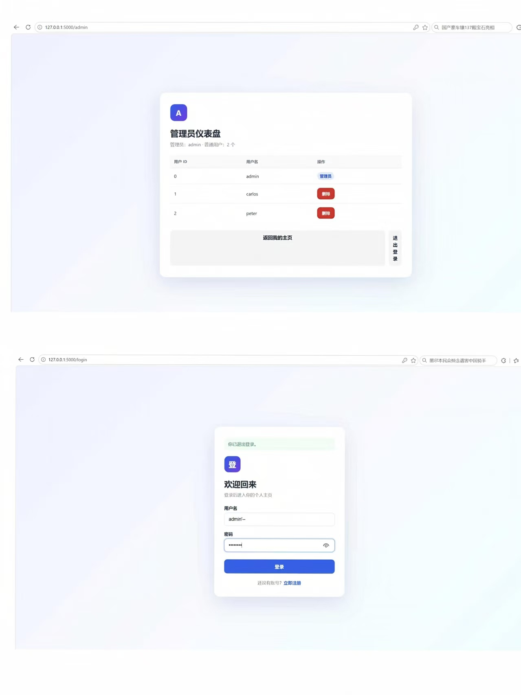
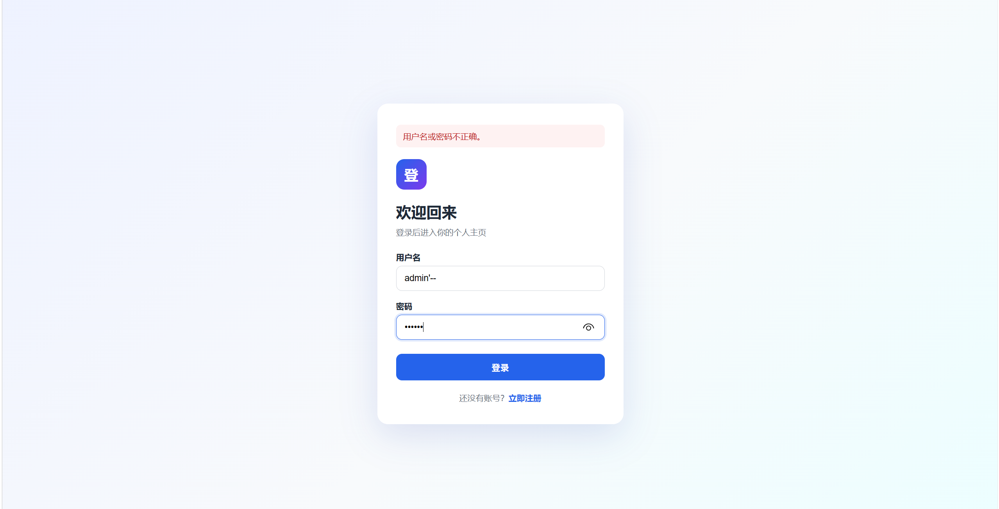
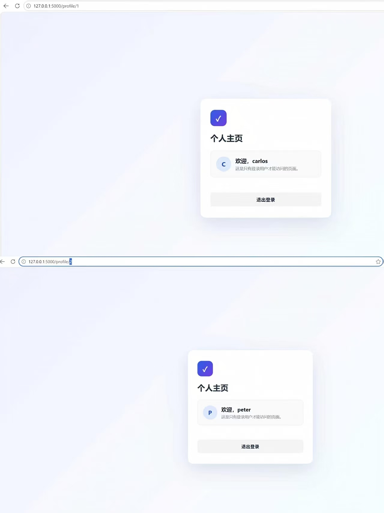
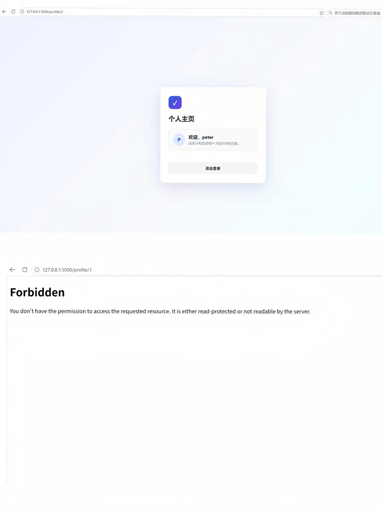
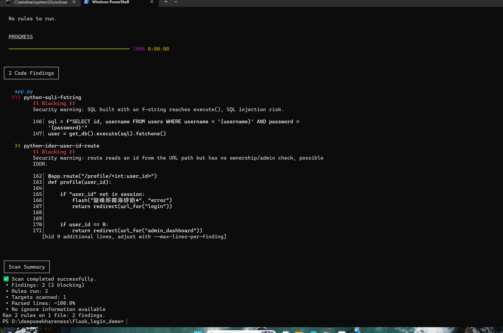

#  AppSec Web Security Demo (Flask)

本项目 Web 安全攻防闭环实践。使用 Python Flask 搭建轻量级 Web 环境，手动复现、验证并修复了 OWASP Top 10 中的常见漏洞，并引入了自研脚本与工业级工具（Semgrep）实现自动化静态代码审计（SAST）。

## 技术栈
- **后端框架**：Python / Flask
- **数据库**：SQLite
- **安全工具**：Burp Suite, Semgrep
- **环境管理**：虚拟环境 (venv)

## 漏洞复现与防御修复

### 1. SQL 注入导致认证绕过 (SQL Injection)
*   **漏洞成因**：登录逻辑（`login` 路由）使用了 `f-string` 字符串拼接构造 SQL 查询，未做参数化处理。
*   **攻击复现**：在用户名处输入 Payload `admin' -- `，成功闭合单引号并注释掉后方密码校验，实现免密登录。
    
*   **防御修复**：将 SQL 查询重构为**参数化查询**（`?` 占位符），从数据库预编译层面彻底切断注入可能。
    

### 2. 水平越权导致数据泄露 (IDOR)
*   **漏洞成因**：个人主页路由（`/profile/<int:user_id>`）直接信任前端传来的 `user_id` 参数，未校验当前用户身份。
*   **攻击复现**：登录普通用户后，篡改 URL 参数 `user_id=2`，成功越权查看他人主页信息。
    
*   **防御修复**：引入 Session 鉴权逻辑，强制判断 URL 参数是否与 `session['user_id']` 一致，不一致直接返回 `403 Forbidden`。
    

> **安全性说明**：本项目为攻防靶场环境。为了直观复现 SQL 注入过程，密码字段采用了明文比对。在真实商业环境中，必须引入 `werkzeug.security` 进行强哈希加密校验，以防止拖库后密码泄露。

## 自动化静态分析 (SAST)

为了将安全防御左移，本项目编写了自动化的代码审计规则：
1. **Semgrep 规则 (`my_rules.yaml`)**：利用抽象语法树（AST）语义分析，编写了针对 `f-string` 注入和未鉴权路由的检测规则，有效降低误报率。
    

## 如何运行
1. 安装依赖：`pip install -r requirements.txt`
2. 创建虚拟环境: `python -m venv .venv`
2. 启动应用：`.\.venv\Scripts\python.exe fixed_app.py`(其中存在漏洞的原始网站为：app.py)
3. 运行 Semgrep 扫描器：`semgrep --config my_rules.yaml app.py`